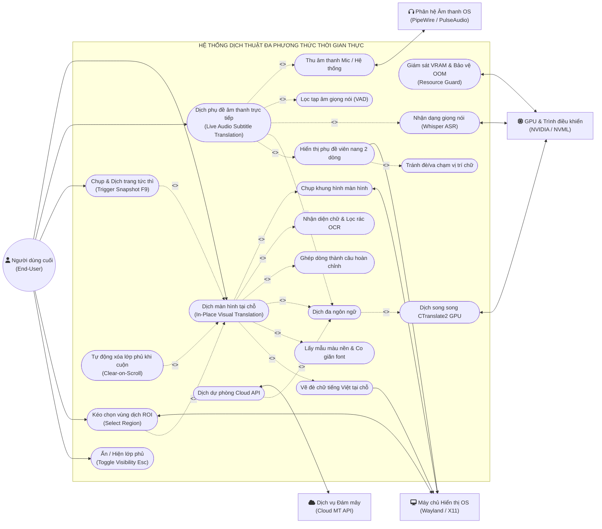

# PHÂN TÍCH HỆ THỐNG: ACTORS, BIỂU ĐỒ PHÂN CẤP CHỨC NĂNG (FDD) & USE CASE TỔNG QUÁT

> **Hệ thống:** Ứng dụng Dịch thuật Đa phương thức Thời gian thực (Visual & Audio Real-Time In-Place Translator)  
> **Phiên bản tài liệu:** 1.0  
> **Ngày lập:** 20/10/2026  

---

## 1. Xác Định Các Actor (Tác Nhân Hệ Thống)

Hệ thống bao gồm **1 Tác nhân chính (Primary Actor)** và **4 Tác nhân phụ / Hệ thống (Secondary / Supporting Actors)**:

| STT | Actor (Tác nhân) | Phân loại | Mô tả vai trò & Trách nhiệm |
| :--- | :--- | :--- | :--- |
| **1** | **Người dùng cuối (End-User)** | *Primary Actor (Con người)* | Người sử dụng hệ thống để chơi game ngoại ngữ, đọc tài liệu/web novel/manga, tham gia hội thảo hoặc xem video. Thực hiện các thao tác: bật/tắt dịch, chọn vùng màn hình (ROI), kích hoạt dịch nhanh (`F9`), ẩn/hiện lớp phủ (`Esc`), chọn chế độ âm thanh/hình ảnh. |
| **2** | **Hệ thống Hiển thị & Cửa sổ OS (Display Compositor / Window Server)** | *Secondary Actor (Hệ thống OS)* | Máy chủ hiển thị (Wayland/Hyprland hoặc X11/XCB hoặc Windows DWM). Chịu trách nhiệm cung cấp luồng chụp màn hình framebuffer (`grim`, `mss`), tạo cửa sổ trong suốt xuyên thấu chuột (*Hardware Click-Through XShape/WS_EX_TRANSPARENT*) và ghim cửa sổ luôn trên cùng (*Always-on-Top*). |
| **3** | **Phân hệ Âm thanh OS (Audio Subsystem)** | *Secondary Actor (Hệ thống OS)* | Phân hệ âm thanh hệ điều hành (PipeWire, PulseAudio, Windows WASAPI). Cung cấp luồng âm thanh thực từ Microphone và luồng âm thanh phát trong máy (*Desktop Audio Loopback*). |
| **4** | **Phần cứng & Trình điều khiển GPU (Hardware & NVIDIA NVML)** | *Secondary Actor (Phần cứng)* | GPU và Driver quản lý VRAM/CUDA, cung cấp năng lực tính toán suy luận AI song song cho ASR (Faster-Whisper), OCR (RapidOCR/ONNX Runtime) và Dịch máy (CTranslate2). |
| **5** | **Dịch vụ Dịch thuật Đám mây (Cloud MT Service)** | *Secondary Actor (Dịch vụ ngoại vi)* | Máy chủ API dịch thuật ngoại vi (Google Translate, DeepL). Đóng vai trò làm cổng dịch dự phòng (*Fallback Translator*) khi người dùng cấu hình online hoặc khi mô hình AI Offline cần bổ trợ. |

---

## 2. Biểu Đồ Phân Cấp Chức Năng (Functional Decomposition Diagram - FDD)

Hệ thống được phân rã thành **5 Phân hệ chính (Cấp 1)**, đi sâu vào các **Nhóm tính năng (Cấp 2)** và các **Chức năng cụ thể (Cấp 3)**:

```mermaid
flowchart TD
    ROOT["HỆ THỐNG DỊCH THUẬT ĐA PHƯƠNG THỨC THỜI GIAN THỰC"]

    %% CẤP 1
    F1["1.0 QUẢN TRỊ & ĐIỀU PHỐI HỆ THỐNG"]
    F2["2.0 DỊCH THUẬT TRỰC QUAN MÀN HÌNH"]
    F3["3.0 DỊCH THUẬT ÂM THANH THỜI GIAN THỰC"]
    F4["4.0 ĐỘNG CƠ DỊCH THUẬT ĐA NGÔN NGỮ"]
    F5["5.0 GIAO DIỆN & LỚP PHỦ XUYÊN THẤU"]

    ROOT --> F1
    ROOT --> F2
    ROOT --> F3
    ROOT --> F4
    ROOT --> F5

    %% CẤP 2 - Phân hệ 1
    F1 --> F11["1.1 Khởi tạo & Nạp Cấu hình (YAML / CLI)"]
    F1 --> F12["1.2 Quản trị Tài nguyên VRAM/RAM (OOM Guard Buffer)"]
    F1 --> F13["1.3 Quản lý Bộ nhớ đệm Thuật ngữ (LRU Cache)"]
    F1 --> F14["1.4 Đồng bộ Đa luồng (Orchestrator Pipeline)"]

    %% CẤP 2 - Phân hệ 2
    F2 --> F21["2.1 Chụp Màn hình (Full Screen / Vùng ROI Slurp)"]
    F2 --> F22["2.2 Phát hiện Chuyển động & Cuộn trang (Clear-on-Scroll)"]
    F2 --> F23["2.3 Nhận dạng Chữ OCR (RapidOCR DBNet & CRNN)"]
    F2 --> F24["2.4 Lọc Nhiễu Ký tự & Loại bỏ Chữ ma"]
    F2 --> F25["2.5 Ghép Dòng & Hợp nhất Câu (Smart Text Stitcher)"]
    F2 --> F26["2.6 Hòa sắc & Tạo kiểu Thẩm mỹ (Aesthetic Blending)"]

    %% CẤP 2 - Phân hệ 3
    F3 --> F31["3.1 Thu âm Đa kênh (Microphone & Desktop Loopback)"]
    F3 --> F32["3.2 Lọc Hoạt tính Giọng nói (Silero/WebRTC VAD)"]
    F3 --> F33["3.3 Nhận dạng Giọng nói Trực tiếp (Faster-Whisper ASR)"]
    F3 --> F34["3.4 Xử lý Phát biểu & Duy trì 2 dòng (2-Line Roll-Up)"]

    %% CẤP 2 - Phân hệ 4
    F4 --> F41["4.1 Dịch Cục bộ GPU Siêu tốc (CTranslate2 Parallel Batch)"]
    F4 --> F42["4.2 Dịch Đám mây Dự phòng (Cloud API Fallback)"]
    F4 --> F43["4.3 Tra cứu Từ điển & Thuật ngữ Chuyên ngành"]

    %% CẤP 2 - Phân hệ 5
    F5 --> F51["5.1 Lớp phủ Xuyên thấu Chuột 60 FPS (PyQt6 Transparent)"]
    F5 --> F52["5.2 Giải quyết Trùng lặp & Va chạm (Collision Resolver)"]
    F5 --> F53["5.3 Thanh Điều khiển Nổi (Mini Floating Toolbar)"]
    F5 --> F54["5.4 Quản lý Phím tắt Nhanh (Hotkeys: F9, Esc, R)"]
```

---

## 3. Sơ Đồ Use Case Tổng Quát (General Use Case Diagram)

Sơ đồ thể hiện toàn bộ tương tác giữa các **Actor** và các **Use Case nghiệp vụ cốt lõi**, bao gồm các quan hệ bao hàm `<<include>>` và mở rộng `<<extend>>`:

---

## 4. Bảng Đặc Tả Tóm Tắt Các Use Case Cốt Lõi

| Mã UC | Tên Use Case | Tác nhân chính | Tiền điều kiện | Luồng sự kiện chính (Main Flow) | Hậu điều kiện |
| :--- | :--- | :--- | :--- | :--- | :--- |
| **UC-01** | **Dịch màn hình tại chỗ** | Người dùng, OS Display, GPU | Ứng dụng đang chạy chế độ Visual, màn hình đang hiển thị văn bản ngoại ngữ. | 1. Hệ thống chụp khung hình tĩnh (hoặc vùng ROI). 2. OCR quét nhận diện chữ và tự lọc bỏ chuỗi rác. 3. Ghép các dòng ngắt thành câu hoàn chỉnh. 4. Dịch GPU song song `<40ms`. 5. Lấy mẫu màu nền xung quanh, ước lượng cỡ font gốc và vẽ đè chữ tiếng Việt lên đúng tọa độ. | Lớp dịch tiếng Việt hiển thị tiệp màu nền, ngay ngắn vừa khít. |
| **UC-02** | **Xóa sạch khi cuộn trang (Clear-on-Scroll)** | Hệ thống, Người dùng | Đang có lớp phủ bản dịch hiển thị trên màn hình. | 1. Hệ thống phát hiện người dùng lăn chuột (`diff >= 3.5%`). 2. Xóa sạch $100\%$ lớp phủ trong $1\text{ms}$. 3. Tạm dừng quét OCR trong lúc đang cuộn. 4. Đợi người dùng dừng cuộn đủ $0.55\text{s}$ mới chụp frame sạch mới để dịch. | Ngăn ngừa hoàn toàn hiện tượng chữ ma quái đè nhau khi đọc web novel/manga. |
| **UC-03** | **Dịch phụ đề âm thanh trực tiếp** | Người dùng, OS Audio, GPU | Chế độ Live Audio được kích hoạt, có âm thanh giọng nói phát ra. | 1. Thu âm qua loopback hệ thống hoặc mic. 2. VAD lọc đoạn có tiếng người nói. 3. Faster-Whisper chuyển hóa thành văn bản tiếng Anh. 4. Dịch sang tiếng Việt. 5. Hiển thị dạng viên nang nổi 2 dòng (2-Line Roll-Up), tự động tránh vị trí ô chữ OCR nếu có va chạm. | Phụ đề hiển thị mượt mà, lưu lại câu trước để người dùng kịp đọc. |
| **UC-04** | **Chụp & Dịch tức thì (Snapshot F9)** | Người dùng | Người dùng muốn dịch ngay trang hiện tại. | 1. Người dùng bấm phím `F9` hoặc nút `[⚡ Dịch Trang Này]`. 2. Hệ thống xóa lớp phủ cũ $\rightarrow$ nghỉ $60\text{ms}$ xóa đệm $\rightarrow$ chụp frame sạch $100\%$ $\rightarrow$ dịch và hiển thị ngay. | Bản dịch trang mới được cập nhật tức thì. |
| **UC-05** | **Kéo chọn vùng quét (ROI)** | Người dùng, OS Display | Người dùng muốn thu hẹp phạm vi quét. | 1. Người dùng bấm phím `R` hoặc nút `[🎯 Chọn Vùng]`. 2. Công cụ `slurp` kích hoạt, người dùng dùng chuột kéo chọn vùng văn bản mong muốn. 3. Hệ thống cập nhật tọa độ ROI mới và dịch ngay vùng đó. | Chỉ nội dung trong khung chữ được dịch, loại bỏ hoàn toàn quảng cáo và sidebar. |
| **UC-06** | **Ẩn / Hiện lớp dịch (Toggle Visibility)** | Người dùng | Đang có bản dịch hiển thị. | 1. Người dùng bấm phím `Esc` hoặc nút `[👁️ Ẩn/Hiện]`. 2. Lớp phủ biến mất ngay lập tức để người dùng đối chiếu chữ gốc. 3. Nhấn lại để hiển thị lại bản dịch. | Người dùng dễ dàng kiểm tra đối chiếu văn bản gốc. |
| **UC-07** | **Giám sát Tài nguyên & Chống tràn VRAM** | GPU Driver, Hệ thống | GPU đang hoạt động suy luận AI. | 1. MemoryController liên tục đo mức tiêu thụ VRAM qua NVML. 2. Đảm bảo tổng dung lượng VRAM luôn dưới ngưỡng trần định mức. 3. Kích hoạt dọn dẹp hoặc offload mô hình nếu chạm ngưỡng cảnh báo. | Hệ thống chạy bền bỉ 24/7, tuyệt đối không bị crash do lỗi Out of Memory (OOM). |
