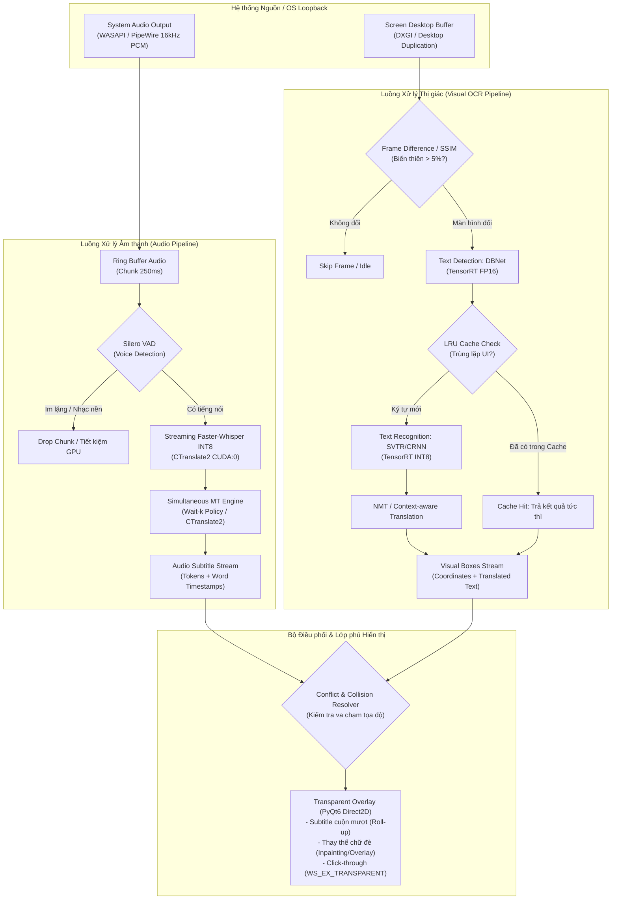
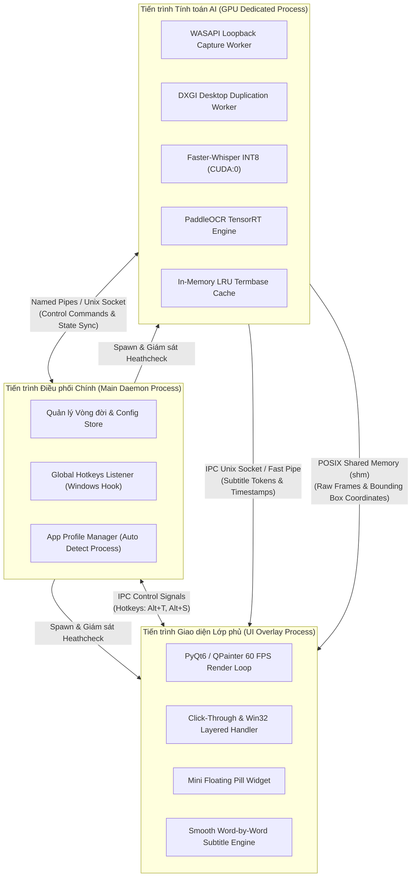
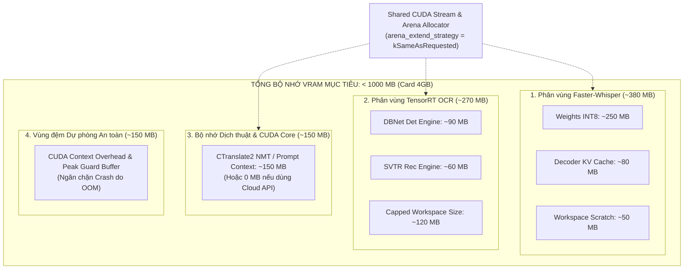
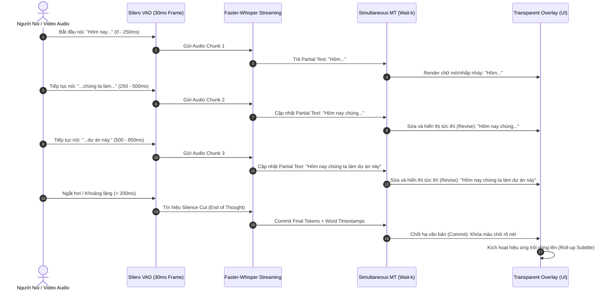
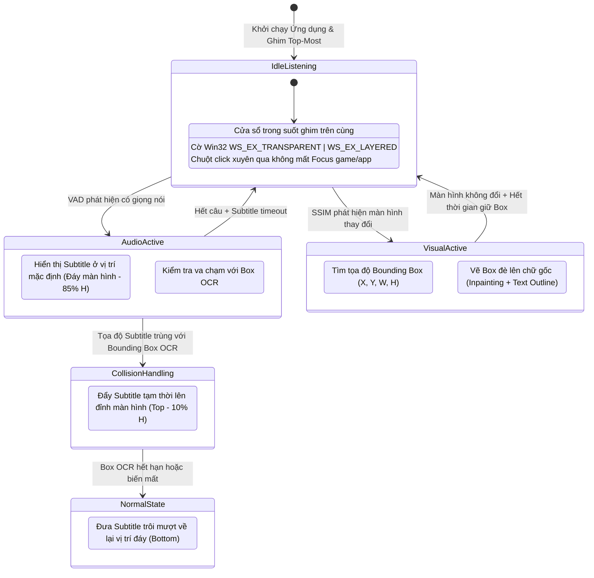

# Hệ thống Dịch thuật Trực quan & Phụ đề Âm thanh Thời gian thực (OmniTranslate)
## Tổng hợp Sơ đồ Kỹ thuật (Mermaid Markdown)

Tài liệu này chứa 5 sơ đồ kiến trúc hoàn chỉnh được chuẩn hóa bằng cú pháp **Mermaid**. Bạn có thể sao chép trực tiếp vào GitHub README, Notion, Obsidian hoặc các công cụ hỗ trợ Markdown.

---

### Sơ đồ 1: Luồng dữ liệu Hợp nhất Thời gian thực (End-to-End Realtime Pipeline)

Sơ đồ mô tả quy trình tiếp nhận đồng thời hai luồng Âm thanh (Audio) và Hình ảnh (Visual), xử lý phân tán qua các mô hình AI tối ưu và hội tụ tại bộ điều phối né va chạm trước khi đẩy ra màn hình.



---

### Sơ đồ 2: Cấu trúc Đa tiến trình & IPC (Multi-Process & IPC Architecture)

Minh họa việc cô lập tiến trình để vượt qua rào cản Python GIL, bảo vệ độ mượt 60 FPS của giao diện Overlay và tối ưu việc truyền nhận dữ liệu lớn qua Shared Memory.



---

### Sơ đồ 3: Phân bổ Bộ nhớ GPU & Giới hạn VRAM (< 1GB Target)

Mô tả cơ chế cấp phát tĩnh và chia sẻ CUDA Context giữa Whisper và TensorRT nhằm đảm bảo không phát sinh phân mảnh bộ nhớ và kiểm soát trần VRAM dưới 950MB.



---

### Sơ đồ 4: Thuật toán Stream-and-Revise (Giảm delay phụ đề âm thanh)

Diễn giải trực quan cơ chế sinh phụ đề tạm thời (Partial Tokens) và cập nhật ngữ nghĩa (Commit) tương tự YouTube Live Caption.



---

### Sơ đồ 5: Kiến trúc Lớp phủ Màn hình & Cơ chế Click-Through (UI Overlay)

Sơ đồ trạng thái hiển thị của lớp phủ màn hình, giải thích cách giải quyết xung đột không gian giữa Text Box OCR và Thanh phụ đề âm thanh.



---

### Bảng tóm tắt cú pháp và công cụ hỗ trợ

| Nền tảng | Cách render | Ghi chú |
| :--- | :--- | :--- |
| **GitHub** | Tự động render trong khối ```` ```mermaid ```` | Hỗ trợ đầy đủ Flowchart, Sequence, StateDiagram |
| **Notion** | Chọn block dạng **Code** $\rightarrow$ Đổi ngôn ngữ sang **Mermaid** | Hiển thị sơ đồ dạng interactive trực quan |
| **Obsidian** | Bao quanh bằng khối ```` ```mermaid ```` | Render native với khả năng zoom/pan mượt mà |
| **GitBook** | Hỗ trợ trực tiếp thông qua Mermaid extension | Phù hợp làm trang Developer Documentation |