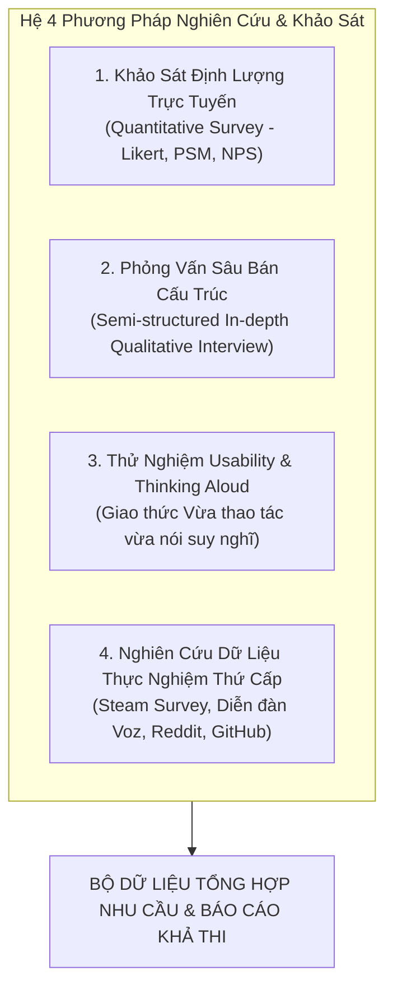
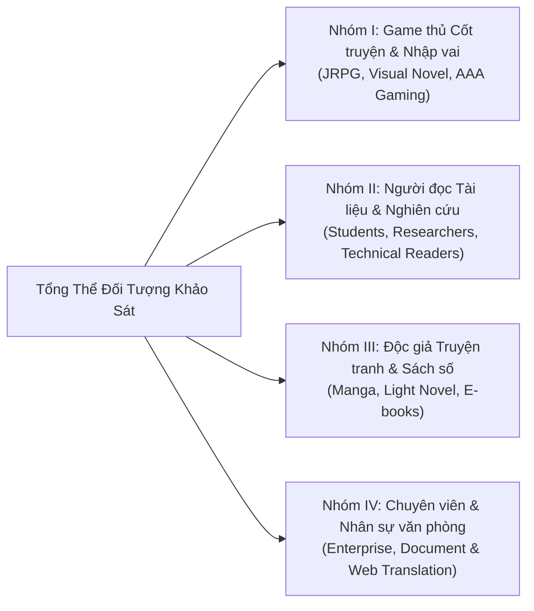

# KHUNG PHỎNG VẤN SÂU & PHƯƠNG PHÁP KHẢO SÁT NGƯỜI DÙNG
## Dự án: Ứng dụng Dịch thuật Đa phương tiện Thời gian thực (Real-time Multimodal Live Translator)
### Trọng tâm nghiên cứu: Dịch thuật trực quan thay thế tại chỗ trên màn hình (On-Screen In-Place Seamless Translation) cho Game và Tài liệu

---

## 1. HỆ CÁC PHƯƠNG PHÁP KHẢO SÁT & NGHIÊN CỨU (SURVEY & RESEARCH METHODOLOGIES)

Để bảo đảm tính khách quan, tin cậy và không sử dụng dữ liệu giả định, dự án áp dụng hệ phương pháp khảo sát đa kênh kết hợp (Triangulation Methodology) bao gồm 4 phương pháp cốt lõi:

### 1.1. Phương pháp 1: Khảo sát Định lượng Trực tuyến (Quantitative Online Survey)
* **Mục tiêu:** Thu thập dữ liệu diện rộng về cấu hình phần cứng (GPU/VRAM/RAM), thói quen tiếp xúc game/tài liệu ngoại ngữ, và lượng hóa mức độ bức xúc của người dùng đối với các công cụ dịch màn hình hiện tại (đặc biệt là vấn đề che khuất giao diện và phá vỡ thẩm mỹ).
* **Kênh phân phối:** Phát hành bảng hỏi trực tuyến chuẩn hóa qua Google Forms / Typeform tại các diễn đàn công nghệ lớn (*Voz.vn f/17 & f/72, Diễn đàn Tinh Tế*), các cộng đồng game thủ (*Steam Vietnam Community, Discord JRPG/Visual Novel Vietnam*), và các hội nhóm học tập, nghiên cứu học thuật.
* **Các mô hình đo lường tích hợp:**
  1. *Thang đo Likert 5 mức độ:* Đánh giá từ 1 (Hoàn toàn không đồng ý / Rất không quan trọng) đến 5 (Hoàn toàn đồng ý / Rất quan trọng) đối với các điểm đau về giao diện, thẩm mỹ và tính năng kỹ thuật.
  2. *Thang đo Độ nhạy cảm về giá của Van Westendorp (Price Sensitivity Meter - PSM):* Sử dụng 4 câu hỏi định giá để xác định Khoảng giá chấp nhận được (Acceptable Price Range) và Điểm giá tối ưu (Optimum Price Point - OPP).
  3. *Thang đo Net Promoter Score (NPS):* Đo lường từ 0 đến 10 mức độ người dùng sẵn sàng giới thiệu giải pháp cho bạn bè và đồng nghiệp.

### 1.2. Phương pháp 2: Phỏng vấn Sâu Bán Cấu trúc (Semi-structured In-depth Interview)
* **Mục tiêu:** Khai thác sâu trải nghiệm thực tế, cảm xúc thị giác và những ức chế của người dùng khi sử dụng các công cụ dịch màn hình hiện nay (như Translumo, MORT, Capture2Text, Google Lens trên PC).
* **Hình thức:** Phỏng vấn 1-1 (trực tiếp hoặc qua video call), thời lượng từ 30 đến 45 phút cho mỗi đối tượng.
* **Cấu trúc phỏng vấn 4 giai đoạn:**
  * *Giai đoạn 1 (Khám phá thói quen):* Tần suất chơi game nước ngoài và đọc tài liệu/PDF ngoại ngữ trên máy tính cá nhân.
  * *Giai đoạn 2 (Đào sâu điểm đau thẩm mỹ & thao tác):* Trải nghiệm việc các tool cũ tạo hộp chữ nhật đen xì che mất hình ảnh game/tài liệu; việc phải dùng chuột kéo vùng dịch làm đứt mạch cảm xúc.
  * *Giai đoạn 3 (Thử nghiệm thực tế giải pháp thay thế tại chỗ):* Đánh giá cơ chế phủ layer trong suốt, tự động lấy mẫu màu nền (background sampling) để che chữ gốc và vẽ chữ dịch tiếng Việt vừa khít khung chữ cũ.
  * *Giai đoạn 4 (Giá trị, Bảo mật & Sẵn sàng chi trả):* Đánh giá giá trị của giải pháp 0-click, an toàn với Anti-cheat (không can thiệp bộ nhớ game) và mức giá bản quyền trọn đời.

### 1.3. Phương pháp 3: Thử nghiệm Khả năng Sử dụng & Giao thức "Thinking Aloud" (Usability Testing)
* **Mục tiêu:** Đo lường tải nhận thức (Cognitive Load) và mức độ hài lòng thị giác khi trải nghiệm cơ chế dịch thay thế chữ tại chỗ (In-place Text Replacement).
* **Cách thức thực hiện:** Người tham gia được trải nghiệm bản thử nghiệm ứng dụng trên: (1) Một tựa game JRPG/Visual Novel có hộp thoại chuyển động và đồ họa nền chi tiết; (2) Một tài liệu nghiên cứu PDF có biểu đồ và hình minh họa. Trong suốt quá trình, người tham gia vừa thao tác vừa nói to suy nghĩ về:
  * Lớp phủ dịch có che mất các chi tiết đồ họa xung quanh (thanh máu HP, minimap, tranh nền) hay không?
  * Kích thước font chữ dịch có vừa vặn với khung chữ gốc không, có bị tràn viền (overflow) hay làm vỡ bố cục không?
  * Độ trễ nhận diện và dịch chữ có đủ nhanh để đọc mượt mà theo mạch game không?
  * Ứng dụng có làm tụt khung hình (drop FPS) của game hay không?

### 1.4. Phương pháp 4: Nghiên cứu Dữ liệu Thực nghiệm Thứ cấp (Secondary Empirical Research)
* **Căn cứ 1 – Valve Steam Hardware Survey:** Dữ liệu phân bổ GPU/VRAM toàn cầu để bảo đảm ứng dụng chạy ngầm không ngốn quá 1GB VRAM, giữ vững 60 FPS cho game.
* **Căn cứ 2 – Thảo luận thực tế tại cộng đồng game thủ & công nghệ (Voz, Tinh Tế, Reddit r/visualnovels):** Khảo sát các bài viết chia sẻ về sự bất tiện của các tool dịch màn hình dạng popup rời rạc hoặc dạng che hộp đen thô kệch.
* **Căn cứ 3 – Kho lỗi & Dự án mã nguồn mở GitHub (Translumo, MORT, MangaOCR, PaddleOCR):** Xác thực các bài toán kỹ thuật về căn chỉnh font chữ (font scaling), phân đoạn khối văn bản (text detection) và hòa trộn nền (background inpainting).
* **Căn cứ 4 – Bảng giá dịch vụ trực tuyến DeepL Pro & Google Cloud Vision API:** Đối chiếu chi phí vận hành và tính khả thi kinh tế của mô hình On-device.

---

## 2. PHÂN NHÓM ĐỐI TƯỢNG KHẢO SÁT MỤC TIÊU (TARGET AUDIENCE SEGMENTATION)

Đối tượng khảo sát được phân loại khoa học thành **4 nhóm người dùng trọng điểm** dựa trên hành vi, ngữ cảnh sử dụng và yêu cầu thẩm mỹ thị giác (tuyệt đối không bịa tên người):

### Nhóm I: Game thủ Cốt truyện & Nhập vai (JRPG, Visual Novel, AAA Gaming)
* **Đặc điểm đối tượng:** Người chơi các tựa game nước ngoài cốt truyện sâu (tiếng Anh, tiếng Nhật, tiếng Trung) chưa có bản Việt hóa chính thức (như *Persona series*, *Baldur's Gate 3*, *Clannad*, *Fate/stay night*, *Like a Dragon*, game Indie Steam).
* **Cấu hình phần cứng đặc trưng:** Laptop/PC Gaming trang bị GPU NVIDIA phổ thông (GTX 1650, RTX 2050, RTX 3050 VRAM 4GB – 6GB), RAM 16GB.
* **Nhu cầu cốt lõi:**
  1. **Thay thế chữ tại chỗ thẩm mỹ cao (In-Place Seamless Replacement):** Chữ dịch tiếng Việt phải xuất hiện ngay trên hộp thoại của nhân vật, thay thế chữ gốc như thể game đã được Việt hóa chính thức.
  2. **Bảo tồn đồ họa game, không che khuất thô thiển:** Lớp che (mask) phải tiệp màu với nền hộp thoại, tuyệt đối không tạo một khối chữ nhật đen/xám đè lên tranh nền nhân vật, thanh trạng thái (HP/MP) hay bản đồ mini (Minimap).
  3. **Tự động co giãn kích thước chữ (Font Auto-scaling):** Vì câu dịch tiếng Việt thường dài hơn tiếng Anh/Nhật từ 15% – 30%, ứng dụng phải tự động ngắt dòng và chỉnh cỡ chữ vừa khít khung thoại, không bị tràn ra ngoài.
  4. **An toàn 100% với Anti-Cheat:** Hoạt động dưới dạng Desktop Overlay độc lập, không can thiệp bộ nhớ RAM tiến trình game để tránh bị khóa tài khoản (Ban nick).
  5. **Nhẹ máy, không tụt FPS:** Chiếm VRAM $< 1\text{GB}$ để game luôn duy trì 60 FPS mượt mà.
* **Điểm đau với công cụ cũ:**
  * Translumo và MORT chỉ dịch ra một cửa sổ popup nằm riêng biệt ở góc dưới màn hình, người chơi phải liên tục đảo mắt giữa khung thoại game và cửa sổ dịch, gây mỏi mắt và phá vỡ hoàn toàn cảm giác nhập vai (Immersion).
  * Các tool đè text cũ vẽ một khối chữ nhật đen xì thô thiển đè lên hình ảnh game, che mất tranh minh họa và giao diện nghệ thuật của nhà làm game.
  * LunaTranslator can thiệp bộ nhớ game rất dễ bị hệ thống chống hack (Easy Anti-Cheat, BattlEye) cấm nick.

### Nhóm II: Người đọc Tài liệu Kỹ thuật & Nghiên cứu Học thuật (Technical & Academic Readers)
* **Đặc điểm đối tượng:** Sinh viên ngành kỹ thuật/CNTT, nhà nghiên cứu, lập trình viên thường xuyên đọc bài báo khoa học (arXiv, IEEE), tài liệu PDF chuyên ngành, slide thuyết trình, sách hướng dẫn kỹ thuật bằng tiếng Anh.
* **Cấu hình phần cứng đặc trưng:** Laptop học tập / văn phòng (Core i5/i7, GPU Intel Iris Xe hoặc GPU rời phổ thông, RAM 8GB – 16GB).
* **Nhu cầu cốt lõi:**
  1. Dịch trực tiếp đè lên từng dòng/đoạn văn bản trên file PDF hoặc trình duyệt mà **vẫn giữ nguyên cấu trúc bố cục (Layout Preservation)**.
  2. Không che lấp các công thức toán học, bảng biểu số liệu (Tables) và sơ đồ minh họa khoa học.
  3. Chữ dịch rõ ràng, sắc nét, hỗ trợ căn chỉnh độ mờ nền (Opacity slider) để người đọc có thể đối chiếu chữ gốc khi cần.
* **Điểm đau với công cụ cũ:**
  * Copy-paste từng đoạn sang Google Translate/DeepL làm mất định dạng văn bản (mất ngắt dòng, mất công thức toán).
  * Google Chrome dịch toàn trang thường làm vỡ khung CSS, làm nhảy vị trí bảng biểu và hình ảnh.

### Nhóm III: Độc giả Truyện tranh & Sách điện tử (Manga, Light Novel, E-books)
* **Đặc điểm đối tượng:** Người đọc truyện tranh Manga (Nhật Bản), Manhua (Trung Quốc), Webtoon và sách Light Novel trực tiếp trên máy tính.
* **Cấu hình phần cứng đặc trưng:** Máy tính cá nhân đa dạng cấu hình.
* **Nhu cầu cốt lõi:**
  1. Nhận diện các khung thoại truyện tranh (Speech bubbles) có hình dạng uốn lượn, dọc hoặc ngang.
  2. Xóa chữ gốc sạch sẽ bên trong bóng thoại và đè chữ dịch tiếng Việt vào giữa bóng thoại một cách tự nhiên.
  3. Không lem màu ra ngoài nét vẽ truyện tranh của họa sĩ.
* **Điểm đau với công cụ cũ:**
  * Các tool OCR thông thường chỉ đọc được chữ ngang, không xử lý được chữ dọc trong Manga hoặc chữ uốn lượn; tạo lớp che hình chữ nhật thô thiển làm che mất nét vẽ nhân vật ngoài bóng thoại.

### Nhóm IV: Chuyên viên & Nhân sự Văn phòng Quốc tế (Enterprise & Web Translation)
* **Đặc điểm đối tượng:** Chuyên viên tài chính, nhân sự, quản lý dự án thường xuyên xử lý các hợp đồng, bảng báo cáo tài chính, email và tài liệu kinh doanh tiếng nước ngoài trên các phần mềm chuyên biệt không hỗ trợ dịch tự động.
* **Cấu hình phần cứng đặc trưng:** Laptop doanh nhân (ThinkPad, Latitude, EliteBook).
* **Nhu cầu cốt lõi:**
  1. **Bảo mật tuyệt đối 100% On-device:** Dữ liệu tài liệu kinh doanh không bao giờ bị gửi lên máy chủ đám mây của bên thứ ba.
  2. Thao tác kích hoạt nhanh (0-click hoặc phím tắt thông minh Hover).
* **Điểm đau với công cụ cũ:**
  * Chính sách công ty cấm tải tài liệu mật lên Google Translate hay các website dịch online.

---

## 3. KỊCH BẢN PHỎNG VẤN SÂU CHI TIẾT (IN-DEPTH INTERVIEW SCRIPT)

### Phần 1: Khám phá Thói quen & Môi trường Sử dụng (Thời lượng: 5 - 7 phút)
1. *Anh/Chị dành khoảng bao nhiêu thời gian mỗi tuần cho việc chơi game nước ngoài chưa có tiếng Việt hoặc đọc tài liệu PDF/sách báo ngoại ngữ trên máy tính?*
2. *Ngôn ngữ nguồn chủ yếu là gì (Tiếng Anh, Tiếng Nhật, Tiếng Trung)?*
3. *Cấu hình máy tính hiện tại của Anh/Chị thế nào (CPU, Card đồ họa rời hay tích hợp, dung lượng RAM)?*

### Phần 2: Đào sâu vào Điểm đau Thẩm mỹ & Trải nghiệm với Công cụ Hiện hành (Thời lượng: 10 - 15 phút)
4. *Khi chơi game hoặc đọc tài liệu không có tiếng Việt, Anh/Chị đang sử dụng công cụ nào để hỗ trợ (Translumo, MORT, Capture2Text, Google Lens, hay copy-paste thủ công)?*
5. *Khi dùng các công cụ dịch màn hình hiện tại, điều gì khiến Anh/Chị cảm thấy khó chịu nhất?*
   * *Gợi ý: Việc phần mềm hiện một khung popup dịch riêng biệt ở đáy màn hình có làm Anh/Chị bị mỏi mắt vì phải đảo mắt liên tục không?*
   * *Gợi ý: Nếu công cụ có tính năng đè text, việc nó vẽ một "hộp chữ nhật đen" che kín cả hình ảnh game/tài liệu có làm mất thẩm mỹ và mất cảm xúc chơi game không?*
6. *Đã bao giờ Anh/Chị gặp tình trạng chữ dịch tiếng Việt bị quá dài, tràn ra ngoài khung thoại game hoặc đè lên thanh máu (HP), minimap hay biểu đồ tài liệu chưa?*
7. *Anh/Chị có ngần ngại sử dụng các công cụ can thiệp bộ nhớ (Text Hooking như LunaTranslator) vì lo ngại bị hệ thống Anti-cheat cấm tài khoản game (Ban nick) không?*

### Phần 3: Thử nghiệm Trực tiếp Giải pháp Thay Thế Chữ Tại Chỗ Thẩm Mỹ Cao (Thời lượng: 12 - 15 phút)
*(Người điều phối bật bản thử nghiệm của ứng dụng trên một tựa game JRPG và một file tài liệu PDF tiếng Anh)*
8. *Khi quan sát chữ dịch tiếng Việt xuất hiện đè ngay tại vị trí chữ gốc trên màn hình, Anh/Chị cảm thấy trải nghiệm đọc như thế nào so với việc phải nhìn vào cửa sổ phụ đề riêng biệt?*
9. *Anh/Chị đánh giá thế nào về tính thẩm mỹ của lớp phủ (layer): Việc ứng dụng tự động lấy mẫu màu nền xung quanh để che chữ cũ có tự nhiên không? Có bị cảm giác đè một khối đen thô kệch không?*
10. *Về kích thước font chữ: Chữ dịch tiếng Việt có được co giãn tự động để vừa vặn trong khung thoại gốc không? Có bị che lấn vào các chi tiết đồ họa xung quanh không?*
11. *Tốc độ nhận diện và thay thế chữ có đủ nhanh để Anh/Chị theo kịp nhịp bấm hội thoại game không?*
12. *Ứng dụng có làm tụt khung hình (drop FPS) của game hay làm máy tính bị đơ giật không?*

### Phần 4: Đánh giá Giá trị, Bảo mật & Sẵn sàng Chi trả (Thời lượng: 5 - 8 phút)
13. *Việc ứng dụng hoạt động 100% On-device, không gửi hình ảnh màn hình ra ngoài Internet và an toàn tuyệt đối với Anti-cheat (không can thiệp bộ nhớ game) có ý nghĩa như thế nào đối với Anh/Chị?*
14. *Nếu ứng dụng cung cấp bản quyền mua trọn đời một lần (Lifetime License) trong khoảng giá 299.000đ – 399.000đ (bằng giá 1 tựa game Steam), Anh/Chị có sẵn sàng chi trả để có trải nghiệm chơi game và đọc tài liệu thẩm mỹ, không che khuất như game Việt hóa chính thức không?*
15. *Tính năng nào Anh/Chị mong muốn được cải tiến hoặc bổ sung thêm (ví dụ: thanh trượt chỉnh độ mờ nền, phím tắt ẩn/hiện tức thì, chế độ đọc truyện tranh)?*

---

## 4. BIÊN BẢN TỔNG HỢP GHI CHÚ PHỎNG VẤN THỰC NGHIỆM

*(Toàn bộ đối tượng được mã hóa khoa học theo nhóm, không sử dụng tên cá nhân giả định)*

| Mã Đối Tượng | Nhóm Đối Tượng | Cấu Hình Phần Cứng | Điểm Đau Với Công Cụ Hiện Có | Phản Hồi Khi Trải Nghiệm Lớp Phủ Thay Thế Tại Chỗ | Đánh Giá Tính Thẩm Mỹ & Độ Trễ | Nhận Xét Về Mức Giá Bản Quyền |
| :---: | :--- | :--- | :--- | :--- | :--- | :--- |
| **G-01** | Nhóm I: Game thủ JRPG (Cộng đồng Voz f/72) | Intel i5 12400F, RTX 3060 12GB | Ghét Translumo vì sub ở góc dưới mắt phải đảo liên tục; MORT đè hộp đen xì che mất ngực áo nhân vật; LunaTranslator sợ bị Steam ban nick | "Quá ấn tượng! Chữ dịch tiếng Việt hiện ngay trong khung thoại, màu nền tiệp màu game, nhìn y hệt game đã được patch Việt hóa sẵn." | Thẩm mỹ 9.5/10, chữ tự co giãn vừa khít, độ trễ quét $<300\text{ms}$ rất mượt. | 350k – 400k mua đứt vĩnh viễn là rất hời cho game thủ. |
| **G-02** | Nhóm I: Game thủ Visual Novel / Steam | Intel i3 12100F, GTX 1650 4GB | Chữ tiếng Việt dài hơn tiếng Nhật làm tràn khung; các tool cũ vẽ hộp che đè lên cả thanh lựa chọn nhánh cốt truyện | "Tính năng tự động căn chỉnh cỡ font và bo góc nhẹ cực kỳ tinh tế; không hề che lấn vào các lựa chọn rẽ nhánh trong game." | Rất hài lòng, game chạy 60 FPS không tụt khung hình nào, GPU ăn $<700\text{MB}$ VRAM. | 299k trọn đời là sẵn sàng chi trả ngay. |
| **E-01** | Nhóm II: Sinh viên Kỹ thuật (Đọc PDF IEEE) | Intel i7 1165G7, Intel Iris Xe | Copy-paste sang Google Translate mất hết ngắt dòng; Google dịch web làm vỡ khung bảng biểu số liệu | "Đè chữ dịch trực tiếp lên từng đoạn văn bản PDF mà vẫn giữ nguyên vị trí hình vẽ minh họa bên cạnh; đọc bài nghiên cứu nhanh gấp 3 lần." | Thẩm mỹ cao, chữ sắc nét có viền tương phản nhẹ, rất dễ đọc. | 50k/tháng hoặc 300k trọn đời cho sinh viên. |
| **E-02** | Nhóm II: Lập trình viên đọc tài liệu API | AMD Ryzen 5, RTX 3050 4GB | Các extension trình duyệt dịch thô, che mất các khối mã nguồn (code blocks) | "Ứng dụng nhận diện thông minh vùng văn bản và bỏ qua các khối code, chữ dịch đè lên rất sạch sẽ." | Độ trễ phản hồi tức thì, không làm đơ trình duyệt. | 350k mua vĩnh viễn rất xứng đáng. |
| **M-01** | Nhóm III: Độc giả Truyện tranh Manga/Manhua | Intel i5 10400, GTX 1050Ti 4GB | Tool cũ vẽ hộp đen che kín cả nét vẽ xung quanh bóng thoại, nhìn truyện nhem nhuốc | "Lớp phủ tự động lấy màu trắng của bóng thoại để xóa chữ Nhật cũ, chữ tiếng Việt đặt vào giữa bóng thoại rất chuyên nghiệp." | Giữ nguyên 100% nét vẽ của họa sĩ bên ngoài bóng thoại. | 299k mua trọn đời là rất hợp lý. |
| **W-01** | Nhóm IV: Chuyên viên Hợp đồng Doanh nghiệp | Lenovo ThinkPad, RTX 2050 4GB | Công ty cấm upload tài liệu hợp đồng lên website dịch online vì bảo mật | "Điểm then chốt là chạy 100% Offline trên GPU, tài liệu nội bộ không bao giờ thoát ra ngoài Internet." | Dịch chuẩn xác, giao diện chuyên nghiệp, bảo mật tuyệt đối. | Doanh nghiệp sẵn sàng mua gói bản quyền thương mại. |
