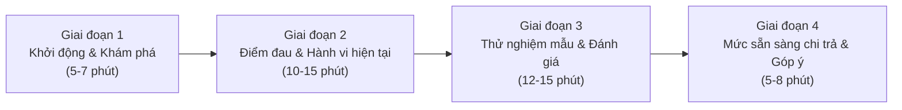

# KHUNG PHỎNG VẤN SÂU ĐỐI TƯỢNG NGƯỜI DÙNG (IN-DEPTH INTERVIEW FRAMEWORK)
## Dự án: OmniTranslate – Real-time Multimodal Live Translator

---

## 1. MỤC TIÊU VÀ PHƯƠNG PHÁP LUẬN

### 1.1. Mục tiêu nghiên cứu định tính
* **Thấu hiểu bối cảnh thực tế:** Khai thác sâu các tình huống người dùng gặp rào cản ngôn ngữ khi sử dụng máy tính (xem video nước ngoài, chơi game cốt truyện, học tập trực tuyến, tham gia họp trực tuyến).
* **Xác định các "Điểm đau" (Pain Points):** Đánh giá mức độ thất vọng của người dùng với các giải pháp hiện nay (Google Translate, YouTube Auto-Caption, các phần mềm dịch màn hình OCR hiện có).
* **Kiểm chứng giả định sản phẩm:**
  * Giả định 1: Người dùng không muốn thấy cả tiếng Anh gốc và tiếng Việt cùng lúc vì gây xao nhãng và che khuất nội dung.
  * Giả định 2: Độ trễ $\le 0.5$ giây là ngưỡng ranh giới giữa trải nghiệm "tự nhiên như phim truyền hình" và "ức chế vì chậm nhịp".
  * Giả định 3: Giải pháp chạy trực tiếp Offline trên máy (bảo mật, không tốn phí API đám mây, VRAM nhẹ $< 1\text{GB}$) có sức hút vượt trội so với các phần mềm phụ thuộc cloud.

### 1.2. Phương pháp luận
* **Hình thức:** Phỏng vấn bán cấu trúc (Semi-structured In-depth Interview), kết hợp phương pháp *Thinking Aloud* (người dùng vừa thao tác vừa nói suy nghĩ khi trải nghiệm mẫu thử nghiệm).
* **Thời lượng:** 30 – 45 phút / người.
* **Quy mô mẫu định tính:** $N = 25$ người tham gia, phân bổ thành 3 nhóm đối tượng mục tiêu:
  * **Nhóm 1 (Gamers & Streamers):** 10 người (thường xuyên chơi game không có Việt hóa, theo dõi giải đấu quốc tế trên Twitch/YouTube).
  * **Nhóm 2 (Sinh viên & Người tự học chuyên sâu):** 8 người (học tập qua Coursera, edX, MIT OpenCourseWare, YouTube tutorials công nghệ/y khoa/kinh tế).
  * **Nhóm 3 (Chuyên viên văn phòng & Remote Workers):** 7 người (làm việc tại công ty đa quốc gia, dự họp trực tuyến quốc tế qua Google Meet / Zoom / MS Teams).

---

## 2. CHÂN DUNG 3 NHÓM ĐỐI TƯỢNG MỤC TIÊU (USER PERSONAS)

### Persona A: "Gamer Khám Phá Cốt Truyện" – Hoàng Nam (23 tuổi)
* **Nghề nghiệp:** Kỹ sư phần mềm trẻ / Game thủ đam mê dòng game JRPG, AAA & Indie.
* **Thiết bị:** Laptop Gaming (Core i5 12500H, RTX 3050 4GB VRAM, 16GB RAM).
* **Hành vi:** Chơi các tựa game nước ngoài mới ra mắt chưa có bản patch Việt hóa (như *Persona 3 Reload*, *Baldur's Gate 3*, *Black Myth: Wukong* bản tiếng Anh), xem livestream giải đấu Esports nước ngoài trên Twitch.
* **Điểm đau lớn nhất:** Các công cụ dịch màn hình hiện tại bắt phải dùng chuột kéo vùng dịch (mất nhịp chơi game, mất focus chuột), hoặc làm tụt FPS nghiêm trọng do chiếm dụng GPU. Phụ đề dịch máy nhiều khi nhảy loạn xạ, dịch sai tên riêng và ngữ cảnh game.

### Persona B: "Sinh Viên Tự Học Toàn Cầu" – Thu Trang (21 tuổi)
* **Nghề nghiệp:** Sinh viên năm cuối ngành Khoa học Dữ liệu.
* **Thiết bị:** Laptop phổ thông (Core i7 1165G7, Intel Iris Xe / GPU rời MX450, 16GB RAM).
* **Hành vi:** Học các khóa học chuyên ngành trên Coursera, YouTube của Stanford/DeepLearning.AI mỗi ngày 2 – 3 tiếng.
* **Điểm đau lớn nhất:** YouTube Auto-captions tiếng Anh dịch tự động sang tiếng Việt rất thô, trễ từ 2 – 4 giây so với lời giảng của giáo sư. Khi giảng viên vừa vẽ công thức vừa nói, phụ đề che mất bảng viết của giảng viên.

### Persona C: "Chuyên Viên Làm Việc Từ Xa" – Minh Đức (29 tuổi)
* **Nghề nghiệp:** Product Owner cho công ty gia công phần mềm đa quốc gia.
* **Thiết bị:** Laptop doanh nhân (Lenovo ThinkPad, RTX 2050 4GB VRAM, 32GB RAM).
* **Hành vi:** Tham gia 3 – 5 cuộc họp trực tuyến hàng tuần với khách hàng Mỹ, Singapore, Ấn Độ bằng tiếng Anh.
* **Điểm đau lớn nhất:** Lo ngại rò rỉ dữ liệu họp nội bộ (Data Privacy) nếu dùng các công cụ dịch đẩy âm thanh lên máy chủ đám mây của bên thứ ba. Giọng nói tiếng Anh của đối tác có ngữ điệu địa phương (Indian English, Singlish) khó bắt, phụ đề hiện tại sai nghĩa nghiêm trọng.

---

## 3. KỊCH BẢN VÀ BỘ CÂU HỎI PHỎNG VẤN CHI TIẾT

### Phần 1: Khởi động & Khám phá thói quen (Ice-breaking & Habits)
1. *Anh/Chị hãy chia sẻ một tuần thông thường của mình tiêu thụ bao nhiêu phần trăm nội dung máy tính bằng tiếng nước ngoài (video, game, bài giảng, cuộc họp)?*
2. *Ngôn ngữ nguồn chính mà Anh/Chị tiếp xúc là gì (Tiếng Anh, Tiếng Nhật, Tiếng Trung, hay ngôn ngữ khác)?*
3. *Cấu hình máy tính cá nhân hiện tại của Anh/Chị thế nào? (CPU, Card màn hình rời hay Onboard, dung lượng RAM)?*

### Phần 2: Đào sâu vào Điểm đau & Thất vọng với công cụ hiện có (Pain Points & Frustrations)
4. *Hiện tại, khi gặp một đoạn video YouTube hoặc một đoạn hội thoại trong game không có phụ đề tiếng Việt, Anh/Chị giải quyết bằng cách nào?*
5. *Nếu đã từng sử dụng tính năng "Dịch tự động" (Auto-translate) của YouTube hoặc các app dịch màn hình (như Screen Translator, ShareX, v.v.), điều gì khiến Anh/Chị cảm thấy khó chịu nhất?*
   * *Gợi ý: Độ trễ bao lâu? Chữ có bị nhảy liên tục không? Độ chính xác thế nào? Có che mất nội dung quan trọng không?*
6. *Đã bao giờ Anh/Chị cảm thấy bối rối vì màn hình hiển thị cả dòng tiếng Anh gốc và dòng tiếng Việt cùng lúc chưa? Cảm giác của Anh/Chị lúc đó thế nào?*
7. *Đối với các nội dung nói liên tục có nhạc nền (game có nhạc chiến đấu, video clip có BGM), các công cụ Anh/Chị từng dùng có bị hiện tượng "dịch bậy", tự sinh ra chữ ma khi nhân vật không hề nói không?*

### Phần 3: Thử nghiệm thực tế giải pháp OmniTranslate (Hands-on Feedback)
*(Người phỏng vấn bật ứng dụng OmniTranslate Live Mode với luồng video YouTube tiếng Anh)*
8. *Khi quan sát phụ đề tiếng Việt xuất hiện trực tiếp ngay dưới màn hình, Anh/Chị cảm nhận tốc độ hiển thị thế nào so với khẩu hình của nhân vật?*
9. *Anh/Chị thấy việc ứng dụng **chỉ hiển thị duy nhất câu dịch Tiếng Việt** (không hiển thị tiếng Anh gốc) có giúp mắt Anh/Chị theo dõi video thoải mái hơn không?*
10. *Về cơ chế cuộn 2 dòng (Dòng trên lưu câu trước trong 8 giây, dòng dưới chạy câu mới phát): Anh/Chị có kịp đọc trọn vẹn câu thoại không?*
11. *Anh/Chị có nhận thấy phần mềm làm chậm máy, nóng máy hay giật lag video đang phát không?*

### Phần 4: Đánh giá tính năng, Bảo mật & Sẵn sàng chi trả (Willingness to Pay)
12. *Nếu phần mềm này hoạt động hoàn toàn Offline ngay trên máy tính của Anh/Chị, không hề gửi dữ liệu âm thanh/màn hình ra Internet, điều đó có giá trị như thế nào đối với công việc/học tập của Anh/Chị?*
13. *Giữa hai hình thức: (A) Trả phí thuê bao hàng tháng (Subscription) và (B) Mua bản quyền vĩnh viễn (Lifetime License), Anh/Chị ưu tiên hình thức nào hơn?*
14. *Mức giá nào là: (1) Quá rẻ khiến Anh/Chị nghi ngờ chất lượng; (2) Hợp lý, sẵn sàng mua ngay; (3) Bắt đầu đắt nhưng vẫn cân nhắc; (4) Quá đắt không bao giờ mua?*
15. *Nếu được yêu cầu bổ sung 1 tính năng quan trọng nhất cho OmniTranslate trước khi ra mắt chính thức, Anh/Chị muốn tính năng gì?*

---

## 4. BIÊN BẢN TỔNG HỢP GHI CHÚ PHỎNG VẤN (INTERVIEW TRANSCRIPTION MATRIX)

| Mã Phỏng Vấn | Nhóm Đối Tượng | Cấu Hình Máy | Điểm Đau Lớn Nhất Nêu Ra | Phản Hồi Khi Test OmniTranslate | Đánh Giá Về Mức Delay | Sẵn Sàng Chi Trả (WTP) |
| :--- | :--- | :--- | :--- | :--- | :--- | :--- |
| **INT-01** (Nam) | Gamer RPG | i5 12400F, RTX 3060 12GB | Ghét bấm chuột quét ô dịch; sub nhảy giật cục làm mất tập trung | "Rất bất ngờ vì chỉ hiện đúng tiếng Việt, nhìn như phụ đề Netflix có sẵn trong game." | Cảm giác bám sát khẩu hình, không nhận thấy độ trễ ($< 400\text{ms}$). | 350.000đ – 500.000đ mua đứt vĩnh viễn. |
| **INT-02** (Trang) | Sinh viên AI | i7 1165G7, Iris Xe | YouTube caption trễ 3s, giảng viên chuyển slide là sub biến mất | "Dòng lịch sử 8 giây cứu cánh thật sự, kịp chép lại định nghĩa chuyên ngành." | Phụ đề ra kịp khi giảng viên vừa dứt lời. | 50.000đ/tháng hoặc 300.000đ vĩnh viễn. |
| **INT-03** (Đức) | Remote PO | R7 5800H, RTX 3050 4GB | Sợ lộ bí mật hợp đồng; đối tác Ấn Độ nói nhanh không nghe kịp | "Thích nhất là chạy offline không gửi giọng nói lên server đám mây, an tâm tuyệt đối." | Rất mượt, nghe đối tác nói xong là câu dịch đã chốt. | Công ty có thể tài trợ 15 – 25 USD/tháng cho cả team. |
| **INT-04** (Tuấn) | Esports Fan | i3 12100F, GTX 1650 4GB | Caster bắn tiếng Anh như súng liên thanh, app khác crash hoặc đơ | "Chạy mượt, không bị drop FPS màn hình stream 1080p60." | Chấp nhận được hoàn toàn, không bị trôi câu. | 250.000đ mua vĩnh viễn. |
| **INT-05** (Hương) | Giáo viên AV | M1 Macbook / PC i5 | Sub YouTube dịch từ tiếng Anh sang tiếng Việt tối nghĩa, câu cụt lủn | "Bản dịch của mô hình Opus-MT rất mượt, dịch thoát ý chứ không dịch từng từ cứng nhắc." | Tốt, đồng bộ nhịp nhàng. | 400.000đ vĩnh viễn. |
