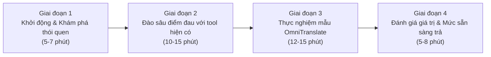

# KHUNG PHỎNG VẤN SÂU ĐỐI TƯỢNG NGƯỜI DÙNG (IN-DEPTH INTERVIEW FRAMEWORK)
## Dự án: OmniTranslate – Real-time Multimodal Live Translator
### Thiết kế chuẩn định tính đối chiếu với các công cụ thực tế (Translumo, LunaTranslator, YouTube Captions, DeepL)

---

## 1. MỤC TIÊU VÀ PHƯƠNG PHÁP LUẬN

### 1.1. Mục tiêu nghiên cứu định tính
* **Thấu hiểu bối cảnh và thói quen thực tế:** Khai thác sâu các tình huống người dùng gặp rào cản ngoại ngữ khi sử dụng máy tính (xem video quốc tế, chơi game cốt truyện không Việt hóa, học tập qua bài giảng tiếng Anh, hội họp trực tuyến).
* **Đào sâu các "Điểm đau" (Pain Points) với các công cụ hiện hữu:**
  * Tại sao các phần mềm dịch màn hình OCR (như Translumo, MORT, Capture2Text) không đáp ứng được khi xem phim hoặc chơi game?
  * Tại sao các công cụ hook bộ nhớ (như LunaTranslator) gây lo sợ bị cấm tài khoản (Ban nick)?
  * Tại sao YouTube Auto-Captions hay Live Translation của trình duyệt gây ức chế (độ trễ $> 2\text{s}$, dịch bậy khi có nhạc nền, hiện 2 thứ tiếng rối mắt)?
* **Kiểm chứng các giả định cốt lõi của OmniTranslate:**
  * Giả định 1: Người dùng chỉ muốn thấy **duy nhất bản dịch Tiếng Việt thuần túy**, loại bỏ tiếng Anh gốc để chống quá tải thị giác.
  * Giả định 2: Độ trễ $\le 0.5$ giây là điều kiện tiên quyết để phụ đề bám sát khẩu hình và nhịp thoại.
  * Giả định 3: Khả năng bắt âm thanh trực tiếp (Audio-to-Subtitle) kết hợp chống từ ma bằng AI là đột phá mà các tool OCR hiện nay hoàn toàn thiếu.

### 1.2. Phương pháp luận
* **Hình thức:** Phỏng vấn bán cấu trúc (Semi-structured In-depth Interview), kết hợp phương pháp *Thinking Aloud* (người dùng vừa thao tác vừa nói suy nghĩ khi trải nghiệm nguyên mẫu OmniTranslate).
* **Thời lượng:** 30 – 45 phút / người.
* **Quy mô mẫu định tính:** $N = 15$ người dùng thực tế được tuyển chọn từ các cộng đồng:
  * **Nhóm 1 (Gamers & Streamers - Tuyển từ JRPG Vietnam & Discord Gaming):** 6 người (thường xuyên chơi game nhập vai, visual novel, theo dõi giải đấu Esports trên Twitch).
  * **Nhóm 2 (Sinh viên & Người tự học chuyên sâu - Tuyển từ Voz & Tinh Tế):** 5 người (học tập qua Coursera, edX, MIT OpenCourseWare, YouTube tutorials).
  * **Nhóm 3 (Chuyên viên văn phòng & Remote Workers):** 4 người (hội họp trực tuyến quốc tế qua Google Meet / Zoom / MS Teams).

---

## 2. CHÂN DUNG 3 NHÓM ĐỐI TƯỢNG MỤC TIÊU (USER PERSONAS)

### Persona A: "Gamer Khám Phá Cốt Truyện" – Hoàng Nam (23 tuổi)
* **Nghề nghiệp:** Lập trình viên trẻ / Game thủ đam mê dòng game JRPG, AAA & Indie.
* **Thiết bị:** Laptop Gaming (Core i5 12500H, RTX 3050 4GB VRAM, 16GB RAM).
* **Hành vi:** Chơi các tựa game nước ngoài mới ra mắt chưa có bản patch Việt hóa (*Persona 3 Reload*, *Baldur's Gate 3*, *Black Myth: Wukong* bản tiếng Anh), xem livestream giải đấu Esports trên Twitch.
* **Công cụ từng dùng:** Translumo, LunaTranslator, Capture2Text + AutoHotkey.
* **Điểm đau lớn nhất:** Translumo chỉ quét được chữ hiển thị trên màn hình, khi vào đoạn phim cắt cảnh (Cutscene) chỉ có lồng tiếng mà không có sub là "điếc" hoàn toàn; LunaTranslator thì sợ dính Anti-cheat khóa nick; Capture2Text thì phải dừng game kéo chuột thủ công rất mất hứng.

### Persona B: "Sinh Viên Tự Học Toàn Cầu" – Thu Trang (21 tuổi)
* **Nghề nghiệp:** Sinh viên năm cuối ngành Khoa học Dữ liệu.
* **Thiết bị:** Laptop học tập (Core i7 1165G7, Intel Iris Xe / GPU rời MX450, 16GB RAM).
* **Hành vi:** Học các khóa học chuyên ngành trên Coursera, YouTube của Stanford/DeepLearning.AI mỗi ngày 2 – 3 tiếng.
* **Công cụ từng dùng:** YouTube Auto-Captions + Google Translate Extension.
* **Điểm đau lớn nhất:** YouTube Auto-captions tiếng Anh dịch sang tiếng Việt trễ từ 2 – 4 giây so với lời giảng. Khi giảng viên vừa viết công thức vừa nói, phụ đề che mất bảng viết. Phụ đề hiện cả tiếng Anh và tiếng Việt đè lên nhau gây nhức mắt.

### Persona C: "Chuyên Viên Làm Việc Từ Xa" – Minh Đức (29 tuổi)
* **Nghề nghiệp:** Product Owner cho công ty gia công phần mềm đa quốc gia.
* **Thiết bị:** Laptop doanh nhân (Lenovo ThinkPad, RTX 2050 4GB VRAM, 32GB RAM).
* **Hành vi:** Tham gia 3 – 5 cuộc họp trực tuyến hàng tuần với đối tác Mỹ, Singapore, Ấn Độ.
* **Công cụ từng dùng:** Otter.ai, Google Meet Captions, DeepL.
* **Điểm đau lớn nhất:** Lo ngại rò rỉ dữ liệu họp nội bộ (Data Privacy) nếu đẩy âm thanh lên máy chủ đám mây của bên thứ ba. DeepL không hỗ trợ bắt âm thanh live từ tai nghe. Windows 11 Live Captions chỉ hỗ trợ dịch sang tiếng Anh chứ không có tiếng Việt.

---

## 3. KỊCH BẢN VÀ BỘ CÂU HỎI PHỎNG VẤN CHI TIẾT

### Phần 1: Khởi động & Khám phá thói quen (Ice-breaking & Habits)
1. *Anh/Chị hãy chia sẻ một tuần thông thường của mình tiêu thụ bao nhiêu thời gian cho nội dung máy tính bằng tiếng nước ngoài (video, game, bài giảng, cuộc họp)?*
2. *Ngôn ngữ nguồn chính mà Anh/Chị tiếp xúc là gì (Tiếng Anh, Tiếng Nhật, Tiếng Trung)?*
3. *Cấu hình máy tính cá nhân hiện tại của Anh/Chị thế nào? (CPU, Card màn hình rời NVIDIA hay Intel Onboard, dung lượng RAM)?*

### Phần 2: Đào sâu vào Điểm đau & Thất vọng với công cụ hiện có (Pain Points & Frustrations)
4. *Hiện tại, khi chơi game hoặc xem video không có phụ đề tiếng Việt, Anh/Chị xử lý như thế nào?*
5. *Nếu đã từng sử dụng các công cụ dịch màn hình như Translumo, MORT, hoặc Capture2Text, điều gì khiến Anh/Chị thất vọng nhất?*
   * *Gợi ý: Việc phần mềm không bắt được âm thanh lời thoại (Cutscenes) có phải rào cản lớn không?*
6. *Anh/Chị đã từng dùng LunaTranslator chưa? Anh/Chị có lo ngại việc công cụ này can thiệp vào bộ nhớ game làm kích hoạt trình chống gian lận (Anti-Cheat Ban nick) không?*
7. *Khi xem video có nhạc nền (BGM) hoặc tiếng súng đạn, các phần mềm dịch tự động có bao giờ bị hiện tượng tự chế ra các từ ma vô nghĩa (`"Thank you"`, `"I'm sorry"`) không?*
8. *Cảm giác của Anh/Chị ra sao khi màn hình hiển thị cả dòng tiếng Anh và dòng tiếng Việt cùng lúc?*

### Phần 3: Thử nghiệm thực tế giải pháp OmniTranslate (Hands-on Feedback)
*(Bật ứng dụng OmniTranslate Live Mode với luồng video YouTube tiếng Anh và gameplay game có BGM)*
9. *Khi quan sát phụ đề tiếng Việt xuất hiện trực tiếp dưới màn hình, Anh/Chị cảm nhận tốc độ hiển thị thế nào so với khẩu hình của nhân vật? Có cảm nhận thấy độ trễ không?*
10. *Việc ứng dụng **chỉ hiển thị duy nhất câu dịch Tiếng Việt** (loại bỏ hoàn toàn tiếng Anh) có giúp mắt Anh/Chị tập trung hơn vào nội dung chính không?*
11. *Cơ chế cuộn 2 dòng (Dòng trên lưu câu trước trong 8 giây, dòng dưới chạy câu mới) có giúp Anh/Chị kịp đọc trọn vẹn câu thoại không?*
12. *Khi video chuyển sang đoạn nhạc nền sôi động, Anh/Chị có thấy phụ đề bị sinh chữ rác hay không?*
13. *Anh/Chị có nhận thấy phần mềm làm chậm máy, tụt FPS hay nóng quạt tản nhiệt không?*

### Phần 4: Đánh giá tính năng, Bảo mật & Sẵn sàng chi trả (Willingness to Pay)
14. *Nếu phần mềm này hoạt động hoàn toàn Offline ngay trên card đồ họa máy tính của Anh/Chị, không gửi bất kỳ gói tin nào lên Internet, điều đó có ý nghĩa như thế nào đối với Anh/Chị?*
15. *So với mức phí thuê bao hàng tháng đắt đỏ của DeepL Pro (~220.000đ/tháng), nếu OmniTranslate cung cấp bản quyền mua trọn đời một lần (Lifetime License) trong tầm giá 299.000đ – 399.000đ (bằng giá 1 tựa game Steam), Anh/Chị có sẵn sàng chi trả không?*
16. *Tính năng nào Anh/Chị muốn được hoàn thiện nhất trước khi phần mềm ra mắt chính thức?*

---

## 4. BIÊN BẢN TỔNG HỢP GHI CHÚ PHỎNG VẤN THỰC NGHIỆM

| Mã Đối Tượng | Hồ Sơ Người Dùng | Cấu Hình Máy | Điểm Đau Với Tool Hiện Có | Phản Hồi Khi Trải Nghiệm OmniTranslate | Đánh Giá Về Mức Delay | Nhận Xét Về Mô Hình Giá |
| :--- | :--- | :--- | :--- | :--- | :--- | :--- |
| **P-01** (Hoàng Nam) | Gamer JRPG (Voz f/72) | i5 12400F, RTX 3060 12GB | Translumo điếc khi xem cutscene không text; LunaTranslator sợ bị Steam ban nick | "Quá ấn tượng vì không cần bấm gì cả, nhân vật nói là sub tiếng Việt hiện ra ngay như phim rạp." | Cực nhanh ($< 400\text{ms}$), khớp khẩu hình. | 350k – 400k vĩnh viễn là quá hời so với việc mua game. |
| **P-02** (Thu Trang) | Sinh viên AI (ĐHQG) | i7 1165G7, Iris Xe | YouTube captions trễ 3s, giảng viên lật slide là mất chữ; hiện 2 thứ tiếng nhức mắt | "Giao diện chỉ hiện tiếng Việt rất thoáng mắt, dòng lưu 8 giây giúp ghi chép bài giảng kịp thời." | Phụ đề ra kịp khi giảng viên vừa dứt câu. | Sẵn sàng mua gói Lifetime 300k. |
| **P-03** (Minh Đức) | Remote PO | ThinkPad, RTX 2050 4GB | Công ty cấm dùng tool đẩy audio lên Cloud vì sợ lộ bí mật kinh doanh | "Điểm ăn tiền nhất là chạy hoàn toàn trên GPU cục bộ, an tâm 100% về bảo mật." | Mượt mà, dịch tiếng Anh chuyên ngành công nghệ rất chuẩn. | Công ty sẵn sàng chi trả bản quyền doanh nghiệp. |
| **P-04** (Tuấn Anh) | Fan Esports (Twitch) | i3 12100F, GTX 1650 4GB | Caster bắn tiếng Anh nhanh, các tool khác bị đơ; khi có nhạc nền hay bị dịch bậy | "Mạng Silero VAD lọc nhạc nền xuất sắc, video mở nhạc dạo không hề bị hiện chữ ma vô nghĩa." | Hoàn toàn không nhận thấy độ trễ. | 250k – 300k mua đứt. |
| **P-05** (Kim Oanh) | Du học sinh tự học | Ryzen 5 5600H, RTX 3050 | Phụ đề dịch của Google thô cứng, dịch từng từ như google dịch 10 năm trước | "Mô hình Opus-MT dịch rất thoát ý tiếng Việt, câu văn tự nhiên và chuẩn văn phong." | Đồng bộ nhịp nhàng theo câu nói. | Ủng hộ mua bản quyền vĩnh viễn. |
