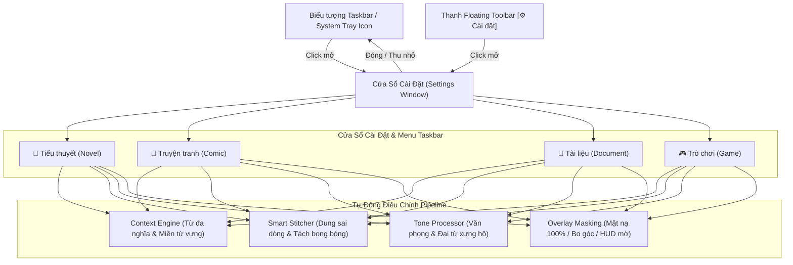

# Kế Hoạch Triển Khai: Cửa Sổ Cài Đặt (Settings Window), Ẩn Taskbar & 4 Chế Độ Dịch Thuật

## Mục tiêu (Goal Description)
Theo yêu cầu của người dùng:
1. **Không dùng phím tắt:** Thay thế hoàn toàn bằng **Cửa sổ Cài đặt trực quan (Settings Window)**.
2. **Ẩn xuống Taskbar / Khay hệ thống (System Tray):**
   * Ứng dụng chạy ngầm với biểu tượng icon dưới Taskbar / System Tray.
   * Khi đóng hoặc thu nhỏ cửa sổ cài đặt, ứng dụng tự động **ẩn xuống Taskbar/Tray** mà không tắt tiến trình dịch.
   * Click vào icon ở Taskbar hoặc click nút `[⚙️ Cài đặt]` trên thanh trôi nổi (Floating Toolbar) để mở lại cửa sổ bất cứ lúc nào.
   * Menu chuột phải tại Taskbar cho phép chọn nhanh 4 chế độ dịch: `📖 Tiểu thuyết`, `🎨 Truyện tranh`, `📄 Tài liệu`, `🎮 Trò chơi`.
3. **4 Chế độ dịch thuật chuyên biệt (Specialized Translation Modes):**
   * 📖 **Tiểu thuyết (Novel Mode):** Văn phong mượt mà, đại từ tôn kính/văn học, ghép trọn đoạn văn lớn (`0.85x`), mặt nạ tiệp màu nền 100% che sạch chữ gốc.
   * 🎨 **Truyện tranh (Comic / Manga Mode):** Nhận diện cụm bóng thoại (speech bubbles), không nối chữ giữa các bong bóng khác nhau, font chữ căn giữa, viền bo tròn mềm mại.
   * 📄 **Tài liệu (Document Mode):** Văn phong học thuật, chính xác, bảo toàn danh sách đánh số (`1.`, `2.`), bullet points, bảng biểu và thuật ngữ chuyên ngành.
   * 🎮 **Trò chơi (Game Mode):** Tối ưu độ trễ thấp (<20ms), thuật ngữ game (tank, buff, aggro, party, boss), mặt nạ HUD bán trong suốt viền đen mờ không che khuất tầm nhìn chiến đấu.



---

## Chi tiết Thiết kế & Triển khai

### 1. Cửa sổ Cài đặt Chuyên Nghiệp ([NEW] `src/ui/settings_window.py`)
* Thiết kế cửa sổ đồ họa hiện đại (Dark Glass UI), bao gồm:
  1. **🎯 Chế độ Dịch (Mode Selector):**
     * 4 ô bấm trực quan có biểu tượng: `📖 Tiểu thuyết`, `🎨 Truyện tranh`, `📄 Tài liệu`, `🎮 Trò chơi`.
     * Khi click chọn, hệ thống áp dụng cấu hình ngay lập tức (không cần khởi động lại).
  2. **⚙️ Động cơ Dịch thuật (Engine):**
     * `⚡ Cục bộ Offline (CTranslate2 - GPU RTX 2050)` (Mặc định - 100% không mạng).
     * `🌐 Hybrid (Cục bộ + Dự phòng Cloud)`.
     * `🤖 LLM (Ollama cục bộ / Gemini API)`.
  3. **🎨 Tùy chỉnh Hiển thị:**
     * Thanh trượt cỡ chữ (Font size: 10px – 28px).
     * Thời gian hiển thị phụ đề (Seconds).
  4. **📊 Thông tin Hệ thống & Phần cứng:**
     * GPU: `NVIDIA GeForce RTX 2050 (4GB VRAM)`.
     * Trạng thái mạng: `100% Offline`.
  5. **Hành vi cửa sổ:**
     * Khi nhấn nút `[X]` hoặc `[-]`: Tự động ẩn xuống Taskbar / Khay hệ thống.
     * Nút `[Ẩn xuống Taskbar]` và `[Thoát Ứng Dụng]`.

### 2. Tích hợp Khay hệ thống & Taskbar ([NEW/MODIFY] `src/ui/tray_icon.py` & `src/main.py`)
* Sử dụng `QSystemTrayIcon`:
  * Biểu tượng khay hệ thống hiển thị logo ứng dụng.
  * **Click chuột trái / Click đúp:** Hiện hoặc Ẩn cửa sổ Cài đặt.
  * **Menu chuột phải:**
    * ⚙️ Cài đặt & Tùy chọn (Mở Settings Window)
    * ⚡ Dịch trang này ngay (Snapshot Translate)
    * 🎯 Chọn lại vùng màn hình (Reselect ROI)
    * 👁️ Ẩn / Hiện bản dịch (Toggle Overlay)
    * ───
    * 📖 Chế độ: Tiểu thuyết
    * 🎨 Chế độ: Truyện tranh
    * 📄 Chế độ: Tài liệu
    * 🎮 Chế độ: Trò chơi
    * ───
    * ❌ Thoát hoàn toàn ứng dụng (Exit)

### 3. Cập nhật Mini Floating Toolbar ([MODIFY] `src/ui/floating_toolbar.py`)
* Thêm nút **`[⚙️ Cài đặt]`** ngay trên thanh công cụ trôi nổi trên màn hình.
* Click vào nút này sẽ mở ngay Cửa sổ Cài đặt mà không cần tìm icon dưới Taskbar.

### 4. Đồng bộ Pipeline với Orchestrator ([MODIFY] `src/core/orchestrator.py`)
* Bổ sung hàm `set_mode(mode: str)`:
  * Cập nhật `stitcher` theo mode (`0.85` cho novel, `0.45` cho comic, `0.65` cho document, `0.40` cho game).
  * Cập nhật `context_engine` khóa miền từ vựng mục tiêu.
  * Cập nhật `tone_processor` chỉnh đại từ xưng hô.
  * Cập nhật `overlay` chuyển đổi kiểu mặt nạ (đặc 100%, bo tròn bong bóng, hay HUD mờ).

---

## Kế hoạch Kiểm thử (Verification Plan)

### Kiểm thử Tự động (Automated Tests)
1. Kiểm thử chức năng khởi tạo và chuyển Mode của `SettingsWindow`:
   ```bash
   .venv/bin/pytest tests/test_settings_and_tray.py
   ```
2. Kiểm thử đồng bộ Preset Mode trong `Orchestrator`:
   ```bash
   .venv/bin/pytest tests/test_modes.py
   ```
3. Chạy toàn bộ test suite để đảm bảo không lỗi:
   ```bash
   .venv/bin/pytest tests/
   ```

### Kiểm thử Trực quan (Manual Verification)
1. Khởi chạy ứng dụng:
   ```bash
   .venv/bin/python src/main.py --visual
   ```
2. Kiểm tra biểu tượng ứng dụng xuất hiện ở **Taskbar / Khay hệ thống**.
3. Click chuột phải vào icon Taskbar: Menu ngữ cảnh hiện đủ các tùy chọn dịch và 4 chế độ.
4. Mở Cửa sổ Cài đặt:
   * Chọn thử `🎮 Trò chơi`: Quan sát mặt nạ chuyển sang dạng HUD mờ viền đổ bóng.
   * Chọn `📖 Tiểu thuyết`: Quan sát mặt nạ chuyển sang che phẳng 100%.
5. Bấm đóng cửa sổ `[X]`: Cửa sổ biến mất mượt mà và ẩn xuống Taskbar, tiến trình dịch vẫn hoạt động bình thường.
